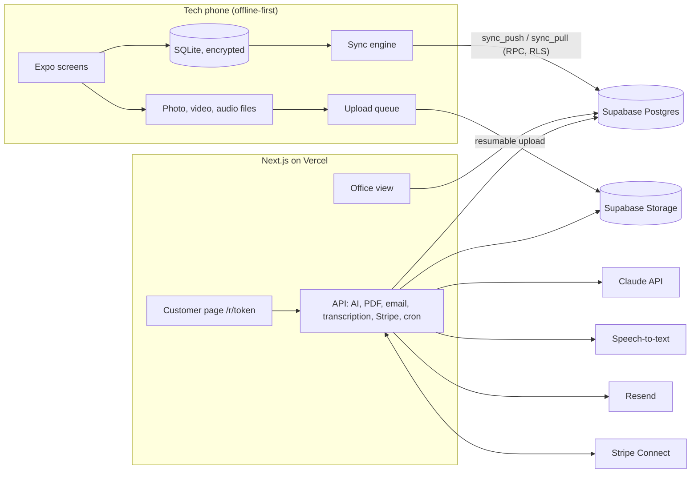

# Tidemark build plan

Status: **approved** (owner delegated the section 10 decisions; see `DECISIONS.md`). Source requirements: [`HANDOFF.md`](HANDOFF.md). Brand: [`../brand/BRAND.md`](../brand/BRAND.md).

This plan takes the handoff's MVP loop to a sellable product. It keeps the handoff's stack with a few changes (section 2), defines the sync model before any screens (section 4), and orders the work into milestones that each end in a stop-and-review (section 8).

---

## 1. Product scope

### 1.1 The core loop (from the handoff, unchanged)

A tech, with no signal at the pool, runs a full inspection (checklist, tests, photos, findings) and gets a customer signature. Back online, they send a branded report with an AI summary they reviewed, send a repair quote the customer accepts and pays a deposit on from their phone, then invoice the job and get paid. The owner sees every job's status on the web.

### 1.2 Beyond the MVP: what to pull in now

| Item from "out of scope" | Call | Why |
|---|---|---|
| **Scheduling (simple)** | **Build now** | The handoff already needs "repair job that can be scheduled." A date, time window, and assigned tech per job, plus a day/week list. No routing. |
| **Follow-up reminders** | **Build now** | Automatic emails for unaccepted quotes and unpaid invoices. Cheap (a daily cron) and directly brings in money. |
| **Review requests** | **Build now** | After an invoice is paid, send the shop's Google review link. A few hours of work; small shops value it. |
| **Warranty tracking** | **Build now (light)** | Warranty term on price book items and repair jobs, plus an "active / expiring" list. The data is already there. |
| **Owner dashboard (basic)** | **Build now (light)** | Jobs by status, quotes sent vs accepted, revenue collected, money outstanding. Simple queries, no charts library sprawl. |
| **Shop signup and Tidemark billing** | **Add (not in handoff)** | Needed to sell the product: self-serve signup, free trial, subscription via Stripe Billing. **Pricing decision needed** (section 10). |
| Insurance adjuster template | Wait | Needs the cousin's input. The template slot exists from day one (section 6.3). |
| Partner portal | Wait | Depends on where jobs come from. The data model already supports partner customers and separate bill-to (section 5). |
| QuickBooks sync | Later | Real demand, but Intuit app review and OAuth upkeep. Revisit after first paying shops. CSV export of invoices and payments now. |
| Route planning (each tech's day, suggestions) | **Added 2026-10-13** (owner) | Milestone M10.5. Fleet dispatch (assigning across techs automatically) is still out. |
| Payroll, inventory, accounting | No | Other products do these. Stay narrow. |

---

## 2. Stack and changes from the handoff

| Area | Choice | Change? |
|---|---|---|
| Mobile | Expo (React Native, TypeScript), latest stable SDK, dev builds via EAS. iOS first. | Same |
| Local storage | `expo-sqlite` with **SQLCipher encryption**; synced rows stored as JSON in one table (see DECISIONS, M2) | Adds encryption: a lost tech phone holds customer names, addresses, gate codes. |
| Sync | **Hand-rolled** outbox and pull, specified in section 4 | Decided against PowerSync, Electric, and WatermelonDB. One tech per job keeps conflicts rare. A small custom engine avoids another paid service and is fully testable. |
| Backend | Supabase: Postgres, Auth, Storage, RLS | Same. Sync runs as Postgres functions under RLS. **No Supabase Edge Functions.** All other server code lives in one place (the Next.js app). |
| Web | Next.js (App Router) on **Vercel Pro** | Same. Vercel Hobby forbids commercial use, so plan on Pro. |
| Server jobs | Next.js route handlers + Vercel Cron | One server codebase for AI, PDF, email, Stripe, transcription, reminders. |
| Payments | Stripe **Connect, Standard accounts, direct charges**, Checkout Sessions (card + ACH) | More specific than "Payment Links". Checkout handles per-quote amounts. With direct charges the shop is merchant of record and owns refunds and disputes. |
| AI narrative | Claude API, server side. Model ID in config (start with `claude-sonnet-5-5`). Structured output plus a validator (section 6.2). | Same, with guardrails spelled out. |
| Transcription | Hosted speech-to-text behind a `transcribe()` interface. Default: Deepgram pay-as-you-go (no monthly fee). | Same |
| PDF | Render the same web report page to PDF with headless Chromium (`puppeteer-core` + `@sparticuz/chromium`) in a Vercel function | Same idea ("HTML template"), and one template serves both the web link and the PDF. Fallback if it misbehaves on Vercel: `@react-pdf/renderer`. |
| Email | Resend, React Email templates | Same |
| SMS | **v1: the tech's phone.** The app opens the native share sheet or a prefilled `sms:` message with the report link. **Twilio later.** | Changed. US business texting through Twilio requires A2P 10DLC registration, which takes weeks and gets complicated when sending for many shops. A text from the tech's own number is also more likely to be read. |
| Monitoring | Sentry (mobile + web), free tier | Added |

### Repository layout (pnpm workspaces)

```
apps/
  mobile/           Expo app (techs; owners can use it too)
  web/              Next.js: office view, customer pages (/r/[token]), API routes, cron, webhooks
packages/
  core/             Domain types, zod schemas, status machines, calculators (bucket test, pressure drop, quote totals). No I/O.
  sync/             Client sync engine. Storage behind an interface, so it runs in Node tests (better-sqlite3) and in Expo (expo-sqlite).
  tokens/           Design tokens generated from brand/tokens.json for RN and Tailwind
supabase/
  migrations/       SQL migrations (schema, RLS, sync functions)
  seed.sql          Default checklist components, test types, report templates, price book, demo company
  tests/            pgTAP tests (RLS isolation, sync merge rules)
brand/              Already exists
docs/               Handoff, this plan, decisions log
```

Tooling: TypeScript strict everywhere, ESLint + Prettier, Vitest (packages, web), jest-expo (mobile units), Playwright (web end-to-end), pgTAP (database). GitHub Actions runs lint, typecheck, and tests on every push.

---

## 3. Architecture overview



- **Tenancy:** every business row has `company_id`. RLS allows a row only when `company_id` matches one of the caller's memberships. The service role is used only inside API routes, and every service-role query filters by an explicit company ID.
- **Roles:** `owner` (admin) and `tech`. Owners manage settings, team, payments, and pricing. Techs do jobs, quotes, and reports. Techs can apply discounts only up to a limit set in company settings.
- **Customer pages** use an unguessable token (`share_link.token`, 128-bit random). No customer login.

---

## 4. Offline and sync design (build this before screens)

### 4.1 Principles

1. The phone's SQLite database is the source of truth for the UI. Screens never wait on the network.
2. Every local write updates the row **and** appends to an outbox in one transaction.
3. IDs are UUIDv7, generated on the device, so records created offline never need renumbering.
4. Conflicts resolve **per field, last writer wins**, ordered by a hybrid logical clock (HLC). Every applied change goes to `audit_log`.
5. Nothing local is deleted until the server confirms it.
6. Deletes are soft (`deleted_at`) so they sync like any other change.

### 4.2 Columns on every synced table (server and local)

| Column | Purpose |
|---|---|
| `id uuid` | UUIDv7 from the device |
| `company_id uuid` | Tenancy |
| `created_at`, `updated_at` | Display only, not used for conflicts |
| `deleted_at` | Soft delete / tombstone |
| `field_hlc jsonb` | Server only: `{ field: hlc }` for the last accepted write per field |
| `sync_xid xid8` | Server only: set by trigger to `pg_current_xact_id()` on insert and update. Used as the pull cursor. |

**HLC format:** `{unix_ms:013}-{counter:04}-{device_id}`. Strings sort lexicographically in time order. Each device keeps its clock as `max(device time, highest HLC seen from the server)`, so a phone with a wrong clock can't win forever.

### 4.3 Push

Local table `outbox(id, table_name, row_id, op, patch_json, hlc, created_at, attempts, last_error)`.

- Before pushing, merge outbox entries for the same row into one patch, keeping the latest HLC per field.
- Call `rpc('sync_push', { mutations })` in batches of at most 200.
- `sync_push` is `SECURITY INVOKER`, so RLS applies. For each mutation it:
  1. Checks `table_name` against `sync_table`, a registry of synced tables and **client-writable columns**. Server-owned columns are never writable from a device, for example payment status, `quote.accepted_at`, and `company_id` after insert.
  2. Skips mutations already applied, by mutation ID in `applied_mutation`, so retries are safe.
  3. Inserts the row if it is new. Otherwise it updates only the fields whose incoming HLC is greater than `field_hlc[field]`, then updates `field_hlc`.
  4. Writes an `audit_log` row for each applied field: user, device, table, row, field, old value, new value, HLC.
  5. Returns `applied`, `partial` (some fields lost to newer writes), or `rejected` (with a reason) for each mutation.
- The client removes outbox entries once they are acknowledged. A rejection keeps the entry, shows a sync problem badge on the job, and is reported to Sentry.

### 4.4 Pull

Pull uses a **transaction-ID watermark**, not timestamps or a plain sequence. A plain sequence can skip rows whose transaction commits after a later sequence value has already been read.

- `rpc('sync_pull', { cursor, limit })`:
  - `high = pg_snapshot_xmin(pg_current_snapshot())`. Every transaction with an ID below `high` has finished.
  - Return rows from all synced tables where `cursor ≤ sync_xid < high`, ordered by `(sync_xid, table_name, id)`, up to `limit`. Use the ordering key to page within a range.
  - Return the next cursor. The client stores it only after applying the page in one local transaction.
- **Applying a pulled row:** write the server row, then re-apply any pending outbox patches for that row on top, so unpushed local edits are never overwritten on screen.
- **Scope:** small shops have small data. Each device pulls **all company records** (not media files) for jobs updated in the last 12 months (configurable), plus all config tables. This avoids the hard problem of a tech losing access when a job is reassigned. Media files download on demand and are cached.

### 4.5 Media

- Capture with the native camera. Compress on the device: photos to a 2048 px long edge, JPEG quality about 0.7. Videos are capped at 60 seconds and compressed with `react-native-compressor`.
- **Keep the original unedited.** Markup (arrows, circles, text) is stored as vector JSON on the media row and drawn on top when displayed or rendered. The photo is evidence; we never bake changes into it.
- Store `captured_at`, GPS (if permitted), and a SHA-256 of the file on the media row. Reports can then show the photos haven't been altered since capture.
- Local `upload_queue(media_id, local_path, attempts, next_attempt_at)`. Upload to `media/{company_id}/{job_id}/{media_id}.{ext}`, using resumable (TUS) uploads for files over 6 MB. Storage RLS limits objects to the caller's company folder. When the upload succeeds, the device writes `media.upload_state = 'uploaded'` through normal sync.
- **When uploads run:** on app foreground, on a network change (NetInfo), after each capture, and when the OS allows a background task (`expo-background-task`). On iOS, background time is not guaranteed, so the app shows "12 photos waiting to upload" until the queue is empty.

### 4.6 Auth while offline

The Supabase session persists on the device. When the access token expires offline, the app keeps working locally and the sync engine waits. It refreshes the token when back online. Set the refresh token lifetime long enough for a week-long trip, and show "Sign in to sync" only if the refresh fails.

### 4.7 Online-only actions

Generating the AI narrative, rendering the PDF, sending, and payments. Before any of these, the app makes sure the job has fully synced (empty outbox for the job, media uploaded) and shows progress if not. Signatures and on-site quote acceptance are captured offline and sync later.

---

## 5. Data model

Money is stored as integer cents. All times are `timestamptz`. Every business table has the sync columns from section 4.2.

Changes from the handoff's rough model, with reasons:

| Change | Reason |
|---|---|
| `user` split into `profile` + `membership(user_id, company_id, role)` | Standard Supabase pattern. Supports invites cleanly. |
| `customer.kind` (homeowner, pool_company, builder, insurer, property_manager, other) and `job.bill_to_customer_id` separate from the property owner | Jobs come from homeowners, pool companies, and insurers, and the payer varies. Ready for the cousin's answers without a rewrite. |
| `job_component` (an instance such as "Return 3") between config and checklist results | Lets components with several instances be numbered and lets findings and photos attach to a specific instance. |
| `test_type` with a JSON field schema, `test_result.data jsonb` | Test types become configuration, as the handoff requires. Math uses named calculators in `packages/core`, not formulas stored as data. |
| `report` is versioned and **frozen once sent** | Legal: what the customer received must never change. Editing after sending creates a new version. |
| `invoice_line_item` added; `quote_line_item` copies the price and description | Price book edits must not change past quotes or invoices. |
| `share_link`, `message`, `applied_mutation`, `sync_table` added | Customer links, send log, sync bookkeeping. |
| Voice notes are `media` with `kind = 'audio'` plus transcript fields | One upload pipeline. |

### Tables

**Tenancy and people**
- `company`: name, legal name, phone, email, address, logo path, `brand_primary`, `brand_secondary`, review link, timezone, `settings jsonb` (deposit rule, tax rate, discount limit for techs, reminder schedule, sync window).
- `profile`: auth user ID, name, phone.
- `membership`: user, company, role (`owner` | `tech`), status (invited, active, disabled).
- `invite`: company, email, role, token, expires.

**Customers and places**
- `customer`: kind, name, company name, email, phone, notes.
- `property`: customer (owner), address, geo, pool type (gunite/plaster, vinyl, fiberglass), has pool, has spa, diagram shape preset, approximate gallons, access notes (gate code), notes.

**Configuration (seeded, editable by owners)**
- `component_type`: key, name, allows multiple, default count, applies when (pool, spa, or both), inspection methods (list), sort order, active.
- `test_type`: key, name, field schema (fields, types, units, required), calculator key (`pressure_drop`, `bucket_evaporation`, or none), result options, sort order, active.
- `severity_level`: key, name, color, sort order. Seed: minor, moderate, major, critical.
- `exclusion_reason`: preset reasons ("No diver on site", "Area not accessible", "Customer declined", "Equipment off"), plus free text.
- `report_template`: key (`homeowner`, `partner`, `insurance`), name, enabled, sections (ordered blocks), AI tone instructions, version. The `insurance` row is seeded **disabled**.
- `price_book_item`: name, description, unit, default price, taxable, warranty months, category, active.

**Jobs and inspection**
- `job`: type (`detection` | `repair`), property, bill-to customer, parent job (repair → detection), status, assigned user, scheduled start, scheduled end, started at, completed at, summary notes.
- `job_component`: job, component type, instance number, label, location note.
- `checklist_item_result`: job component, status (`pending` | `inspected` | `excluded`), method, exclusion reason (required when excluded, enforced in DB and UI), notes, inspected at, inspected by.
- `test_result`: job, job component (optional), test type, `schema_version`, `data jsonb`, computed values, outcome (pass, fail, inconclusive), performed at.
- `finding`: job, job component (optional), title, location text, severity, `pin_x`, `pin_y` (0–1 on the diagram), status (`open` | `quoted` | `repaired` | `monitor`), notes.
- `media`: job, finding/component/test (optional links), kind (`photo` | `video` | `audio`), storage path, upload state, mime, size, SHA-256, width/height/duration, captured at, GPS, `markup jsonb`, caption, transcript, transcript status.
- `signature`: job, report or quote (optional), purpose (`inspection_ack` | `quote_acceptance` | `work_authorization` | `completion`), signer name, signer role, image path, signed at, GPS, device.

**Documents and money**
- `report`: job, template key, version, status (`draft` | `sent` | `superseded`), AI draft (`jsonb`), final sections (`jsonb`), data snapshot (`jsonb`, frozen when sent), model, prompt version, PDF path, sent at.
- `quote`: job, number, status (`draft` | `sent` | `accepted` | `declined` | `expired`), subtotal, discount, tax, total, deposit rule and amount, valid until, accepted at, accepted by name, acceptance IP and user agent, repair job ID (set when accepted).
- `quote_line_item`: quote, finding (optional), price book item (optional), description, quantity, unit price, taxable, warranty months, sort.
- `invoice`: job, quote (optional), number, status (`draft` | `sent` | `partially_paid` | `paid` | `void`), subtotal, tax, total, amount paid, due date, sent at, paid at.
- `invoice_line_item`: same shape as quote line items. Deposits paid appear as a credit line.
- `payment`: company, invoice or quote, amount, method (`card` | `ach` | `other`), status (`pending` | `succeeded` | `failed` | `refunded`), Stripe Checkout Session ID, Stripe PaymentIntent ID, paid at.
- `stripe_account`: company, Stripe account ID, charges enabled, payouts enabled, details submitted.
- `share_link`: company, token, job, report (optional), quote (optional), invoice (optional), expires at, revoked at, last viewed at, view count.
- `message`: company, job, channel (`email` | `sms_device`), recipient, template, status, provider ID, error.
- `warranty`: repair job, line item, starts on, ends on, terms.

**System**
- `audit_log`, `applied_mutation`, `sync_table`, `subscription` (Tidemark billing per company).

### Job status machine (in `packages/core`, enforced in the DB)

`unscheduled → scheduled → in_progress → report_sent → quote_sent → quote_accepted → invoiced → paid`, plus `canceled`. Detection jobs with no repair skip the quote steps. Repair jobs start at `unscheduled` when a quote is accepted. The office view shows these as the handoff's labels.

---

## 6. Feature specs that need extra precision

### 6.1 Checklist

- When a job is created, instantiate a `job_component` for each active component type that applies (spa only if the property has a spa), using default counts. The tech adds or removes instances ("+ Return").
- An item cannot be marked `excluded` without a reason. The report always lists excluded items with reasons in a "Not inspected" section, which is the legal point.
- A job cannot move to `report_sent` while any item is `pending`, unless the tech confirms "Mark remaining as not inspected" with a reason.

### 6.2 AI narrative guardrails

- **Input** is built on the server from synced database rows, never from text the client sends: property, components, checklist results (including exclusions), tests with computed values, findings, and the tech's notes and transcripts.
- **Output** is structured JSON: `sections[] → paragraphs[] → { text, source_ids[] }`, where `source_ids` point to findings, tests, or checklist rows.
- **Validator** (in `packages/core`, unit-tested with adversarial fixtures):
  - Every `source_id` exists in this job.
  - Every number in the text (PSI, inches, minutes, counts) appears in the source data, allowing for formatting.
  - Every component named exists in this job.
  - Findings with severity `major` or `critical` must be mentioned.
  - On failure, retry once with the errors listed. If it still fails, show the draft with each problem highlighted for the tech.
- The tech edits plain text per section on the phone. The report shows **only tech-approved text**. Store the AI draft, the final text, the model ID, and the prompt version for the record.
- Homeowner tone: plain language, what was found, what it means, recommended next step. Partner tone: technical, component by component, test values.

### 6.3 Report rendering

- One Next.js page renders a report from its frozen `data snapshot` and `final sections`, using the template's ordered blocks: header (shop branding), summary, findings (with diagram and pins), tests table, checklist coverage (inspected and **not inspected with reasons**), photos (with markup drawn on top), signature, quote (if any), footer ("Powered by Tidemark").
- The PDF is that same page printed by headless Chromium, stored in Storage, and regenerated only when a new version is sent.
- Sign-off (owner, 2026-10-13): the customer reads the report on the tech's phone ("Review with Customer") and signs at the bottom. Signing finishes and locks that version; "Customer Not Here" finishes it unsigned and the report says so. Finishing never waits for a signature, and every finished version has its PDF.
- **Shop colors:** pick the text color automatically (white or near-black) for contrast against the shop's brand color. Never assume the shop chose an accessible color.
- **Insurance slot:** the template row exists (disabled), the block system supports it, and settings show it as "Coming soon". Enabling it later is a seed and template change, not code.

### 6.4 Quotes and payments

- **Quote builder:** pick findings, and each finding suggests price book items by component type. Tap to add, then edit quantity, price, and description. Totals use the `packages/core` calculator: line totals, discount, tax on taxable lines, deposit.
- **Deposit rule** (company setting): percent of total or fixed amount, with a minimum. Default 50%, to be confirmed with the cousin.
- **Acceptance:** on the customer page (typed name, terms checkbox, optional drawn signature; store IP and user agent), or on site on the tech's phone (signature with purpose `quote_acceptance`, synced later).
- **Deposit and invoice payment:** a Stripe Checkout Session created **on the shop's connected account** (direct charge) with card and US bank account (ACH). ACH settles over several days, so status stays `pending` until the `checkout.session.async_payment_succeeded` webhook arrives.
- **Webhooks** at `/api/stripe/webhook` are verified, idempotent (stored event IDs), and handle Connect events. They update `payment`, `quote`, `invoice`, and `job` status.
- **Accepted quote:** creates the repair job (`unscheduled`), links the findings, and notifies the office.
- **Connect onboarding:** owners click "Set up payments" in settings and go through Stripe-hosted onboarding. Until charges are enabled, customer pages show the quote and an "accept" button but no pay button, and the office sees a warning.

### 6.5 Sending

- **Email:** from `"{Shop name} via Tidemark" <reports@{sending domain}>`, with reply-to set to the shop's email. Contains a link to `/r/{token}` and the PDF attached (under 5 MB, otherwise link only).
- **Text:** the native share sheet or `sms:` with a prefilled message, for example "Example Leak Co.: your leak detection report and repair estimate: {link}". Logged as `message.channel = 'sms_device'`.

### 6.6 Pool diagram

A set of top-down shape presets (rectangle, oval, kidney, L-shape, freeform-ish, each with an optional attached spa) drawn with `react-native-svg`. Findings drop pins at normalized coordinates. Components such as skimmers and returns can be placed as icons. The same SVG renders on the web report.

---

## 7. Security and data integrity checklist

- RLS on **every** table, tested with pgTAP. Two companies are seeded, and every table is tested for "company A cannot read or write company B's rows" for both `owner` and `tech`.
- Storage policies scoped by the company folder, also tested.
- Service-role key exists only on the server. Customer pages query by token through server code that also checks `company_id`, revocation, and expiry.
- Customer-facing endpoints are rate limited (token lookup, accept, checkout creation).
- Sent reports are immutable. Original photos are immutable, with SHA-256 stored.
- Encrypted SQLite on the device, and data wiped on sign-out.
- Daily backups: Supabase Pro includes them. Turn on point-in-time recovery when revenue justifies it.
- Data export per company (CSV of customers, jobs, invoices, payments) for trust and for QuickBooks import.

---

## 8. Milestones

Each milestone ends with: all checks green (lint, typecheck, unit, pgTAP, Playwright where relevant), a commit, a short summary to the owner of what was built, and **decisions to weigh in on**. Do not start the next milestone until the owner says go.

### M0 Foundation
- pnpm monorepo per section 2, TypeScript strict, ESLint, Prettier, Vitest, GitHub Actions CI.
- `packages/tokens` generated from `brand/tokens.json` (RN theme object + Tailwind preset).
- `.env.example` for every app, listing every variable in section 11.
- Supabase project config (`supabase/config.toml`) and migration tooling. Local database for tests: use `supabase start` if Docker works; otherwise run migrations and pgTAP against the local Postgres 16 with a small shim that adds the `auth` schema, `auth.uid()` from `request.jwt.claims`, and the `anon`/`authenticated`/`service_role` roles.
- **Done when:** `pnpm lint && pnpm typecheck && pnpm test` passes in CI on an empty skeleton.

### M1 Schema, RLS, auth, seed
- All migrations for section 5, RLS policies, status-machine constraints, `sync_table` registry.
- Seed: default component types, test types, severities, exclusion reasons, report templates (insurance disabled), sample price book. Demo company with a demo owner and tech.
- Auth: email + password and magic link. Company signup creates company + owner membership. Owner invites tech by email.
- **Done when:** pgTAP proves cross-company isolation on every table and storage bucket, and exclusion-without-reason is rejected by the database.

### M2 Sync engine (no screens yet)
- `sync_push` and `sync_pull` Postgres functions per section 4, with pgTAP tests for field-level LWW, idempotent retry, server-owned column rejection, and watermark correctness (concurrent transaction test).
- `packages/sync`: outbox, HLC, patch merge, push and pull loops, apply-with-pending-overlay, upload queue logic. Runs against a storage interface.
- **Done when:** Node integration tests run two simulated devices against the local database through offline edits, conflicting edits, retries after network failure, and deletes, and end in the same state with a complete audit log.

### M3 Mobile shell
- Expo app with dev build config, brand fonts, icons, splash, light theme from tokens, 48 px tap targets.
- Sign in, company context, encrypted local DB with Drizzle migrations, sync engine wired to `expo-sqlite`, sync status indicator (synced, pending count, problem).
- Jobs list (today / upcoming / recent), create customer + property + job fully offline, job detail shell with tabs (Checklist, Tests, Findings, Report).
- **Done when:** in airplane mode a tech can sign in (cached session), create a customer, property, and job, kill the app, reopen, and see it. Turning the network on syncs it, and it appears in Supabase.

### M4 Inspection
- Checklist with component instances, inspected (with method) or excluded (with required reason), notes.
- Tests: forms generated from `test_type` schemas. Calculators for pressure drop and bucket/evaporation, with pass/fail suggestions the tech can override.
- Findings with severity, component link, and pins on the pool diagram presets.
- **Done when:** a full sample inspection (2 skimmers, 4 returns, main drain excluded, spa, 5 pressure tests, 1 bucket test, 2 dye tests, 2 findings with pins) can be done offline and syncs correctly. Calculator unit tests cover edge cases.

### M5 Media
- Photo and short video capture attached to a component, finding, or test. On-device compression, markup editor (arrow, circle, text) stored as vector JSON, SHA-256, GPS, timestamps.
- Voice notes recorded offline. Transcription runs on the server once uploaded and syncs back.
- Background upload queue per section 4.5, with a visible pending count and retry.
- **Done when:** 30 photos and 2 videos captured offline upload after reconnecting without duplicates (including when the app is killed mid-upload), and markup displays over unchanged originals.

### M6 Web foundation and office view
- Next.js app with Supabase SSR auth, Tailwind with brand tokens, light and dark.
- Public home page (what Tidemark is, sign in, start trial) using the brand.
- Jobs list with status filters, job detail (read-only inspection view, media gallery, timeline from the audit log), customers and properties with visit history, simple schedule (day and week list by tech).
- Settings: company profile and branding (logo upload, colors with contrast preview), team and invites, price book, component types, test types, exclusion reasons, severities, report templates (text and tone only), deposit and tax rules.
- **Done when:** Playwright covers sign in, invite tech, edit price book, view the M4 sample job. A tech account cannot reach settings.

### M7 Reports, signatures, sending
- Signature capture on the phone (offline), by purpose.
- AI narrative with the section 6.2 guardrails, an edit screen on the phone, homeowner and partner templates, insurance slot shown as "Coming soon".
- Customer page `/r/[token]` rendering the frozen report, PDF generation and storage, email via Resend, text via share sheet, send log, report versioning.
- **Done when:** the validator rejects every adversarial fixture (invented finding, wrong PSI, missing critical finding), the sample job produces both templates as web page and PDF, and an email arrives with a working link.

### M8 Quotes and deposits
- Quote builder from findings and price book on the phone (works offline), edit lines, totals, deposit.
- Quote on the customer page, accept online or on site, Stripe Connect onboarding in settings, deposit via Checkout (card + ACH), webhooks, repair job creation, schedule the repair from the office.
- **Done when:** in Stripe test mode a customer accepts and pays a deposit by card and by test ACH from a phone-sized browser. Statuses update through webhooks, and replaying a webhook changes nothing.

### M8.5 Field parity with the design partner's current tool
Added 2026-10-13 after reviewing his current reports (`docs/research/2026-10-13-current-report-system.md`).
- Checklist verdicts per item: Not leaking, Leaking, Attention, Not applicable (no reason needed); "where" and photos per item; Leaking or Attention offers a finding.
- Checklist sections (Visual inspection, Plumbing static test, Bond beam) and his item list as the default checklist; yes/no items for vinyl checks.
- Report: pass / attention / leaking counts, every item with its verdict by section, leaks noted, detection fee, techs, date performed, large first photo, findings repaired on site.
- Shop disclaimer setting printed on every report; detection fee on the job; a second tech per job; booking questions (why they called, pool and spa size); several emails per customer; report numbering continues from a starting number.
- **Done when:** the sample job, entered the way he works (two techs, 27 items, one leaking item repaired on site), produces a report with the counts, the itemized verdicts, the fee, and the disclaimer, as a web page and PDF; the phone checklist works offline.

### M9 Invoicing and payment
- Invoice from a completed job (detection fee and/or repair), deposit credited, send, pay via Checkout, statuses (`draft`, `sent`, `partially_paid`, `paid`, `void`), receipts, CSV export.
- **Done when:** the full definition of done from the handoff passes end to end in test mode. Write it as a scripted Playwright + device checklist.

### M9.5 Website parity with the app
Added 2026-10-13 (owner: "the app and website should essentially be the same"; demos use the website on a phone). The website does everything the app does, except working with no signal: on the website every change saves straight to the server, with the same database rules.
1. Every office page works on a phone (390 px): navigation, lists, job page, schedule, settings.
2. Job page actions: start, finish, cancel; checklist results and "where"; tests with the calculators; findings with diagram pins.
3. Photos and videos from the browser's camera, markup, voice notes, and on-screen signatures.
4. Quote builder: from findings and the price book, discount, send.
- **Done when:** at phone width in Playwright, a job is started, its checklist worked, a test and a finding with a pin added, a photo uploaded and marked up, the customer signs, a quote is built and sent, and the report is sent, all from the website.

### M10 Beyond the MVP
Built 2026-10-13: reminders and review requests (daily cron), warranties, owner dashboard, Tidemark billing with read-only when unpaid. Checklist: `docs/testing/M10-checklist.md`.
- Quote and invoice reminder emails (Vercel Cron, schedule in company settings, stops when accepted or paid).
- Review request after payment (shop's review link, once per job, opt-out per customer).
- Warranty records from accepted repair lines, active and expiring list.
- Owner dashboard: jobs by status, quote acceptance rate, collected and outstanding, by month.
- Shop self-serve signup with trial and Tidemark subscription (Stripe Billing on the platform account), access locked gracefully when unpaid (read-only, never data loss).
- **Done when:** each feature has tests, and a new shop can sign up, start a trial, onboard Stripe, and run the full loop without help.

### M10.5 Routes and scheduling
Added 2026-10-13 (owner: "assign routes to specific days and techs, suggestions based on existing routes, rearrange the schedule quickly, real addresses, Open in Maps"). Design notes: `docs/ROUTE_OPTIMIZATION_HANDOFF.md`. Checklist: `docs/testing/M10.5-checklist.md`.
- Pools and the shop on the map: looked up from the address (Mapbox, when `MAPBOX_TOKEN` is set) or marked with the phone's GPS. Drive times from Mapbox's Matrix API, cached a day and counted per shop; an estimate from distance without a key.
- Schedule: each tech's day as a route with drive times, short gaps, total driving, back-at-shop time, and overtime. Plan Route orders a day for the least driving, keeping started jobs, promised times, and two-tech jobs. Drag jobs between places, techs, and days (mouse, touch, keyboard) or use Move…; jobs without a time wait in a tray with Suggest Times. Week view drags between days.
- Suggest Times on the job page, the schedule tray, and New Job (existing pools): the gaps in the next working days that add the least driving.
- Addresses link to directions in the phone's maps app (job page, schedule, Today, phone app); Open Route in Maps (a whole day); Today: a tech's route with On My Way (text from the tech's phone) and Call.
- Settings › Scheduling: working day and days, usual job length, arrival windows, shop location, find pool locations.
- **Done when:** in Playwright, a tech's badly ordered day is planned (less driving, the promised time kept), a job moves from the tray onto a day with Move… and back by dragging, a suggested time schedules it, and the addresses on the job page and Today link to directions to the pool.

### M10.6 Maintenance (regular pool cleaning)
Added 2026-10-13 (owner: "This company does regular pool cleaning too... regular maintenance visits (default 20 or 30 minutes), recurring on a weekly basis with some settings there"). Checklist: `docs/testing/M10.6-checklist.md`.
- Maintenance plans on a customer's pool (owners): tech, first visit (the weekday), every 1 to 4 weeks, optional set time (otherwise route planning picks it), visit length (30 minutes by default), price per visit, last visit, notes for the tech. Pause, resume, or end.
- Visits are jobs of type Maintenance, made a few weeks ahead (Settings › Scheduling) when a plan is saved and every morning; they go on routes, Today, and phones like any job. A visit has the service checklist (skim, brush, vacuum, baskets, filter pressure, water, equipment) and ends with Mark Done.
- **Done when:** in Playwright, an owner adds a weekly plan, its 30-minute visit is on the tech's route the next day, the visit is started, its checklist done, and it is marked Done, and pausing the plan takes the upcoming visits off the schedule.
- Not yet: monthly billing for maintenance (owner: one invoice per customer per month for the visits done); water-chemistry readings and a service summary email (on hold, ask the cousin).

### M11 Launch hardening
- Sentry, error boundaries, offline edge cases (full disk, revoked session, app update with pending outbox), accessibility pass, performance with 1,000 jobs and 10,000 photos on the device.
- EAS production builds, TestFlight, App Store and Play listings (screenshots, demo account for review), privacy policy and terms (owner provides final legal text), support email, status page.
- **Done when:** a TestFlight build has been used by the design partner on real jobs for at least one week with no data loss.

---

## 9. Testing strategy

| Layer | Tool | What it proves |
|---|---|---|
| Database | pgTAP | Tenant isolation, required exclusion reasons, status constraints, sync merge rules, watermark |
| Domain | Vitest | Calculators, quote and invoice totals, status machine, AI output validator, HLC |
| Sync | Vitest + better-sqlite3 + local Postgres | Multi-device offline scenarios end to end |
| Web | Playwright | Office flows, customer page at phone width, Stripe test mode |
| Mobile | jest-expo for units; the owner and design partner test on real devices at each milestone with a short scripted checklist | UI on real hardware (the cloud environment cannot run an iOS simulator) |

---

## 10. Decisions for the owner

Please answer these before or during the milestone listed. The **recommendation** is what the build does by default.

| # | Decision | Recommendation | Needed by |
|---|---|---|---|
| 1 | Texting: tech's own phone (share sheet) in v1, Twilio later? | Yes | M7 |
| 2 | Stripe: Standard connected accounts with direct charges (shop is merchant of record)? | Yes | M8 |
| 3 | Sales tax: one configurable rate per company with taxable flags per line, no automatic tax service? | Yes, and ask the cousin whether repairs are taxed in his state | M8 |
| 4 | Default deposit: 50% of quote total? | Confirm with the cousin | M8 |
| 5 | What gets signed on site: inspection acknowledgment, work authorization, on-site quote acceptance, completion? | Support all four, turn on per company | M7 |
| 6 | Tidemark pricing: per shop per month, per tech, or per job? Trial length? | Flat per shop with a tech cap (for example, up to 5 techs), 30-day trial; decide the price after the design partner pilot | M10 |
| 7 | Monthly running cost at launch of about $45–60 plus usage (section 12)? | Yes | M0 |
| 8 | Domain name and sending domain (for example `tidemark.app`, email from `send.tidemark.app`) | Buy once the name is cleared | M7 |
| 9 | App Store: publish under your own Apple Developer account (individual or company)? | Company account (needs a D-U-N-S number, which takes days, so start early) | M11 |

Open questions for the cousin, from the handoff, still apply: checklist items and procedures, current report examples and readers, typical repair items and prices, insurance frequency and adjuster needs, job sources and who pays. Each lands as seed or config data.

Added 2026-10-13 (maintenance): should cleaning visits record water-chemistry readings (chlorine, pH, alkalinity, ...), and should customers get a short service summary email after each visit?

---

## 11. Accounts, keys, and environment

Create these before M0 (Supabase), M7 (AI, email), and M8 (Stripe). Add keys to the cloud environment's settings, not to chat or the repo. A new session picks them up.

| Variable | Service | Needed by |
|---|---|---|
| `SUPABASE_URL`, `SUPABASE_ANON_KEY`, `SUPABASE_SERVICE_ROLE_KEY`, `SUPABASE_DB_URL` | Supabase dev project | M1 (local tests can run without it) |
| `EXPO_TOKEN` | Expo / EAS | M3 (device builds) |
| `ANTHROPIC_API_KEY` | Claude API | M7 |
| `DEEPGRAM_API_KEY` | Speech-to-text | M5 |
| `RESEND_API_KEY`, `EMAIL_FROM_DOMAIN` | Resend + verified domain | M7 |
| `STRIPE_SECRET_KEY`, `STRIPE_WEBHOOK_SECRET`, `STRIPE_CONNECT_CLIENT_ID` | Stripe test mode with Connect enabled | M8 |
| `SENTRY_DSN` (mobile, web) | Sentry | M11 (can be earlier) |
| `APP_BASE_URL` | Vercel deployment URL | M7 |
| `MAPBOX_TOKEN` (default scopes, no URL restrictions; server only), `ROUTING_DAILY_LIMIT` (optional) | Mapbox | M10.5 (works without it, with estimated drive times) |

The environment's network policy must allow outbound traffic to Supabase, Stripe, Anthropic, Deepgram, Resend, Mapbox, Expo, and npm.

---

## 12. Running costs (estimates; verify at signup)

| Service | Dev | Live |
|---|---|---|
| Supabase | Free | Pro, about $25/mo |
| Vercel | Free (Hobby, non-commercial) | Pro, about $20/mo |
| Apple Developer | n/a | $99/yr |
| Google Play | n/a | $25 once |
| Expo EAS | Free tier | Free tier at first |
| Resend | Free tier | Free tier up to its limit, then about $20/mo |
| Claude API, Deepgram | Pennies | Usage: a few cents per report, under a cent per voice-note minute |
| Stripe | Free | Per transaction, paid by the shop on direct charges |
| Domain | About $15/yr | Same |
| Sentry | Free tier | Free tier |

Roughly **$45–65/mo fixed** once live, plus small per-job usage.

---

## 13. Risks

| Risk | Mitigation |
|---|---|
| Sync bug loses field data | Outbox never deleted before acknowledgment, audit log of every field change, multi-device tests in M2, a "send diagnostics" export in settings |
| iOS limits background uploads | Upload on foreground and network change, visible pending count, warn before sign-out or uninstall while uploads are pending |
| AI states something the tech didn't record | Structured output, validator, tech approval required, only approved text shown |
| Shops find Stripe onboarding confusing | Hosted onboarding, clear status in settings, quotes still work before payments are set up |
| Report disputes years later | Frozen sent versions, immutable originals with hashes, signatures with time and place, exclusion reasons |
| Scope creep before the design partner validates | Milestone stops, decisions log in `docs/DECISIONS.md` |
